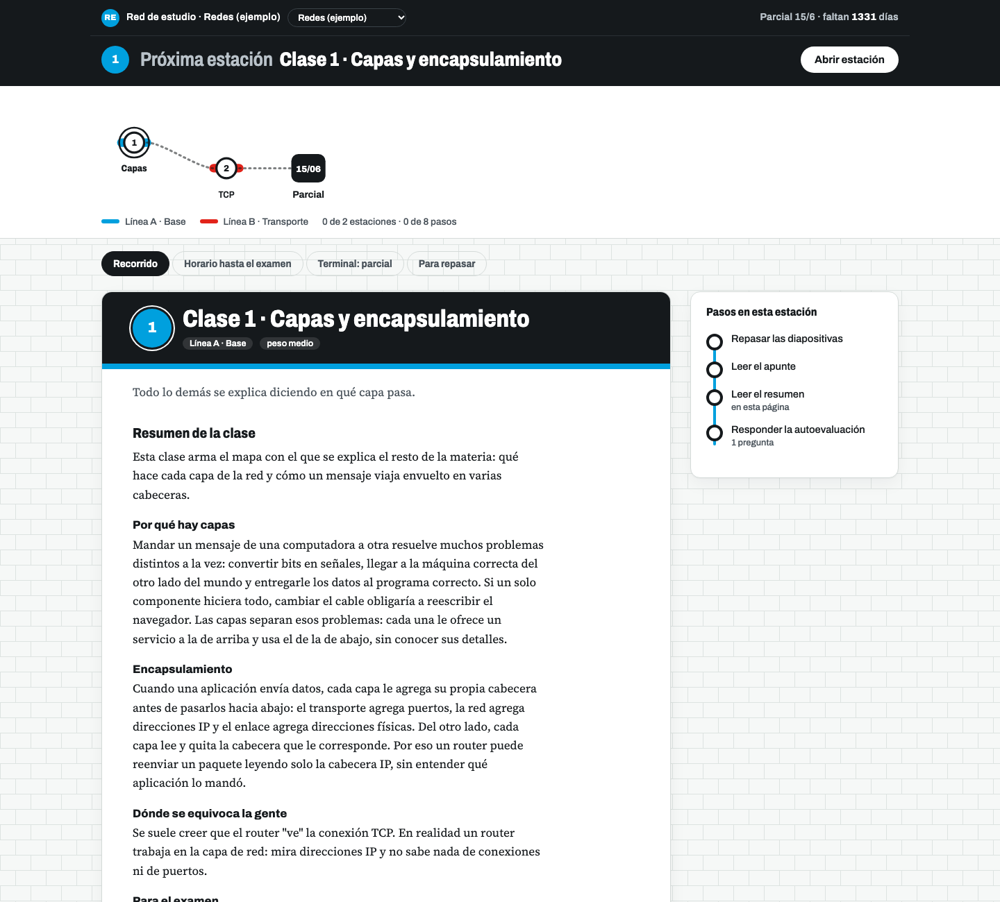

# Subte Estudio

Una ruta de estudio para preparar un parcial o un final, armada como una línea de subte: cada clase es una estación, cada bloque temático es una línea de color y la terminal es el examen. En cada estación tenés el video y el audio de la clase, un resumen escrito a fondo y una autoevaluación de preguntas de casos que respondés por escrito o dictando, y que corrige un modelo de lenguaje que corre en tu compu.

El contenido de cada materia (resúmenes, preguntas, plan) lo arman agentes de Claude Code a partir de los PDFs de la cátedra. El motor es el mismo para cualquier materia.



**¿Primera vez?** Seguí la guía [Cómo se usa, paso a paso](app/ayuda.md). También está dentro de la app, en la pestaña "Cómo se usa".

## Qué hace

- **Recorrido:** diagrama de la red con las estaciones completas, la actual y la próxima. Cada estación tiene cuatro pasos: video, audio, resumen y autoevaluación.
- **Autoevaluación:** preguntas de casos con respuesta de referencia y puntos clave. La respuesta de referencia no se muestra hasta que escribís al menos ocho palabras o marcás "No la sé".
- **Corrección:** el corrector marca cada punto clave como presente, parcial o ausente y te devuelve, en frases cortas y sin elogios, qué te faltó y qué dijiste mal y cómo es en realidad. Por defecto usa [Ollama](https://ollama.com) con un modelo local; también puede usar Gemini.
- **Dónde se explica:** cada pregunta enlaza a la sección del resumen que la responde.
- **Resumen de tus errores:** al calificar todas las preguntas de una clase, el corrector arma qué tenés que reforzar (qué fallaste, cómo es lo correcto y un ejercicio para fijarlo) y qué secciones releer.
- **Escuchar el resumen:** lo lee en voz alta y resalta el párrafo que va leyendo, con velocidad ajustable. Voces: Microsoft (neuronal, acento argentino, gratis y sin clave), Piper (local, gratis y sin internet), Gemini (usa créditos) o la del sistema. Al empezar prepara en segundo plano el audio de toda la clase, o de todas, y lo guarda en `cache/`.
- **Editar el resumen:** desde la app, quitás párrafos, puntos, tablas o secciones enteras con un toque, o editás el texto. Hay deshacer, el original queda en `resumen/originales/` y las versiones anteriores en `resumen/versiones/`.
- **Explicame:** seleccionás una parte del resumen, escribís qué querés saber de ella (o usás una pregunta rápida, o lo dejás vacío) y el modelo te responde simple y con un ejemplo, usando el resumen de la clase como fuente; podés seguir preguntando y guardar la idea en tus apuntes.
- **Mis apuntes:** al lado de cada resumen, un espacio por clase para escribir lo esencial; seleccionando texto del resumen se agrega con un toque. La pestaña "Mis apuntes" los junta todos y los descarga en Markdown.
- **Dictado:** grabás tu respuesta con el micrófono y ves en vivo lo que va entendiendo (reconocimiento de voz del navegador). Al terminar, [whisper.cpp](https://github.com/ggml-org/whisper.cpp) la pasa en limpio en tu compu, si está configurado; si no, queda el texto del navegador.
- **Horario:** plan por días hasta el examen.
- **Terminal:** material general, examen modelo y la guía de cómo responder.
- **Para repasar (repaso espaciado):** cada pregunta mal o a medias vuelve en 1 hora, después al día siguiente, a los 3 días y a la semana. Si fallás, vuelve a empezar.

El progreso y tus respuestas se guardan solos en `progreso/<materia>.json` (fuera de git), con una copia por día en `progreso/copias/`.

## Requisitos

- Python 3.9 o más nuevo (el servidor no usa dependencias externas).
- Para corregir: [Ollama](https://ollama.com) y un modelo. Con 32 GB de RAM o más, `qwen3:30b` corrige bien; con menos memoria probá `qwen3:14b` o `qwen3:8b`. Los modelos chicos (por ejemplo `qwen2.5:7b`) aprueban respuestas incorrectas: en una prueba le pusieron 6 sobre 10 a una respuesta que decía lo contrario de la referencia.
- Para escuchar los resúmenes con voces gratis: `bash scripts/instalar_voces.sh` (instala edge-tts y Piper dentro del proyecto y baja la voz argentina de Piper).
- Para dictar: `whisper-cli` y `ffmpeg` (`brew install whisper-cpp ffmpeg`) y un modelo ggml de whisper, por ejemplo `ggml-large-v3-turbo-q5_0.bin`.
- Para armar materias nuevas: [Claude Code](https://claude.com/claude-code) y, para extraer texto de PDFs, `pip install pypdf` o `brew install poppler`.

## Uso

```bash
git clone https://github.com/Tomas093/Subte-Estudio.git
cd Subte-Estudio
cp .env.example .env          # ajustá el modelo y la ruta de whisper
ollama pull qwen3:30b
python3 server.py
```

Abrí `http://127.0.0.1:8765`. Si tenés varias materias, elegís cuál en el selector de arriba o con `?m=<slug>`.

### Configuración (`.env`)

| Variable | Para qué |
|---|---|
| `SUBTE_PROVEEDOR` | `ollama` (local) o `gemini` |
| `SUBTE_MODELO` | Modelo de Ollama, por defecto `qwen3:30b` |
| `GEMINI_API_KEY`, `GEMINI_MODELO` | Solo si usás Gemini; se cobra por uso según la tarifa de Google |
| `MS_VOZ`, `PIPER_VOZ` | Voz por defecto de Microsoft y de Piper |
| `GEMINI_VOZ`, `GEMINI_TTS_MODELO`, `GEMINI_VOZ_ESTILO` | Voz de Gemini, modelo de voz e instrucción de tono |
| `VOZ_PARALELO` | Cuántos párrafos genera a la vez al preparar el audio |
| `WHISPER_MODELO` | Ruta al modelo ggml de whisper.cpp |
| `WHISPER_IDIOMA` | Idioma del dictado, por defecto `es` |
| `SUBTE_DATOS` | Carpeta del progreso, por defecto `progreso/`. Poné una de iCloud o Dropbox para usarlo en varias compus |
| `PUERTO` | Puerto del servidor, por defecto 8765 |

## Armar una materia nueva con agentes

Abrí Claude Code en la carpeta del repo y pedile algo como:

> Usá el skill nueva-materia para armar Bases de Datos con los PDFs de ~/Descargas/bd. El parcial es el 12/11.

El skill [`nueva-materia`](.claude/skills/nueva-materia/SKILL.md) coordina estos agentes:

| Agente | Qué hace |
|---|---|
| [`ingestor`](.claude/agents/ingestor.md) | Copia los PDFs, extrae el texto, detecta clases y fases, y escribe `materia.json` |
| [`resumidor`](.claude/agents/resumidor.md) | Escribe el resumen de cada clase: cada tema con el problema, el mecanismo, un ejemplo, el costo y el error típico |
| [`preguntador`](.claude/agents/preguntador.md) | Escribe de 8 a 12 preguntas de casos por clase con referencia, puntos clave y errores que invalidan |
| [`guia-examen`](.claude/agents/guia-examen.md) | Escribe "Cómo responder el examen" a partir del examen modelo y su pauta |
| [`auditor`](.claude/agents/auditor.md) | Revisa que cada pregunta se pueda responder con el resumen de su clase: si falta la explicación la agrega, si el tema no está en el material saca la pregunta, y completa `donde` |

Si en una materia ya armada hay preguntas que piden cosas que el resumen no explica, pedile a Claude Code: "Usá el skill auditar-preguntas con la materia <slug>".

Los videos y audios por clase se generan aparte en NotebookLM y se enlazan en `materia.json`; el skill explica cómo.

## Estructura de una materia

```
materias/<slug>/
  materia.json              clases, fases, examen, plan, enlaces, reglas de corrección
  resumen/claseNN.md        resumen de cada clase
  resumen/como-responder.md guía del examen (opcional)
  preguntas/claseNN.json    [{pregunta, referencia, claves[], errores[], donde}]
  fuentes/                  PDFs de la cátedra y su texto en fuentes/txt/
```

`python3 scripts/validar.py materias/<slug>` revisa que todo esté completo. [`materias/ejemplo`](materias/ejemplo) es una materia mínima inventada para probar el motor.

## Privacidad

Las materias reales quedan fuera de git (`.gitignore` ignora todo `materias/` salvo el ejemplo): el material de la cátedra no se sube. El servidor escucha solo en `127.0.0.1`. El dictado en vivo usa el reconocimiento de voz del navegador: en Chrome pasa por los servidores de Google. Con Ollama, tus respuestas no salen de tu compu; con Gemini, se envían a Google.
